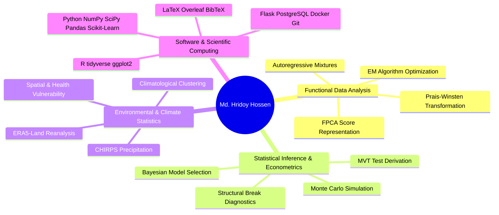

# 👨‍🔬 MD. HRIDOY HOSSEN
### **Academic Researcher & Statistician**
**Department of Statistics & Data Science, Islamic University, Kushtia, Bangladesh**

[-1E3A8A?style=for-the-badge&logo=academia&logoColor=white)](#-education--academic-background)

[-059669?style=for-the-badge)](#)

 

---

## 📌 Executive Summary
Statistics graduate and researcher specializing in **Functional Data Analysis (FDA)**, **Time Series Econometrics**, and **Environmental / Hydro-Climatological Statistics**. worked as a **Research Assistant** on a UGC-funded national climate project and pursuing an M.Sc. by thesis at Islamic University, Kushtia. Experienced in developing likelihood-based mixture models, high-dimensional clustering, massive Monte Carlo simulation engines, and full-stack computational infrastructure for scientific data.

---

## 🌟 Primary Research Frontier: Functional Data Analysis (FDA)

### 📈 Current M.Sc. Thesis Project
> **"Model-Based Clustering of Climatological Functional Data with Temporal Dependence: An Autoregressive Mixture Model for Bangladesh Monsoon Rainfall"**
> *Supervised at Department of Statistics & Data Science, Islamic University, Kushtia*

* **Core Innovation:** Formulating a likelihood-based finite mixture framework for repeated annual functional trajectories with an explicit **Gaussian AR(1) dependence structure** across observation years, relaxing classical independence assumptions.
* **Mathematical Derivations:**
  - Evaluated on pooled Functional Principal Component Analysis (FPCA) score vectors $\boldsymbol{\xi}_{i,t} \in \mathbb{R}^d$.
  - Incorporated a **Prais–Winsten transformation** with exact lower-triangular Jacobian $(1-\phi^2)^{d/2}$ preserving observed-data likelihood:
    $$\mathcal{L}(\boldsymbol{\Theta}) = \prod_{i=1}^N \left[ (1 - \phi^2)^{d/2} \sum_{g=1}^G \pi_g \prod_{t=1}^T f_d\left(\tilde{\boldsymbol{\xi}}_{i,t};\, a_t(\phi)\boldsymbol{\mu}_g,\, \boldsymbol{\Sigma}_g\right) \right]$$
* **Computational Estimation:** Generalized EM algorithm with numerically optimized autoregressive parameter $\phi$, likelihood safeguards, BIC/ICL cluster selection, and effective sample size scaling $T_{\text{eff}} = T\frac{1-\phi}{1+\phi}$.
* **Application Dataset:** High-resolution ERA5-Land daily precipitation reanalysis for Bangladesh (1950–2025; 76-year continuous multi-decadal grid).

---

## 🏛️ Established Domains & Previous Research Portfolio

### 1. 🌦️ Climatological Reclassification & Unsupervised Learning (UGC Funded)
> **Manuscript Under Peer Review:** *"A Cluster Analysis of Bangladesh's Monthly Climate and Its Comparison with the Traditional Six-Season Calendar"* (Submitted to *Theoretical and Applied Climatology*, 2026)
> *Authors: Md. Matiur Rahman Molla, Md. Hridoy Hossen, Ayesha Siddika* | 
* **Dataset:** 30 years (1985–2014) of monthly ground observations comprising **10,865 station-months** across 33 BMD weather stations in a 6-variable climate space ($T_{\max}, T_{\min}$, rainfall, humidity, wind speed, cloud cover).
* **Methods:** K-Means, DBSCAN, Hierarchical Agglomerative Clustering, PCA, Dynamic Time Warping (DTW).
* **Key Finding:** Robust empirical climatological proof for a 4-season regime with October as an independent transition month, challenging conventional historical calendar models.
* 🔗 **Repository:** [Bangladesh-Seasonal-Reclassification](https://github.com/hossenhridoy56/Bangladesh-Seasonal-Reclassification)

### 2. 📉 Time Series Variance Stability & Asymptotics
> **"A Novel Massive Variance Stability Test: Theory, Distributional Derivations, and Superior Performance Under Structural Breaks"**
>   
* **Theoretical Contribution:** Formulated the Massive Variance Stability Test (MVT) statistic:
  $$Q_{\mathrm{MVT}} = \frac{m-1}{2\bar{v}^2} \sum_{j=1}^k (v_j - \bar{v})^2 \overset{d}{\longrightarrow} \chi^2_{k-1}$$
  evaluating homoskedasticity under segmented sample regimes without prior break-location assumptions.
* **Empirical Validation:** 4,997 daily Gold Futures price observations (2005–2026), 10,000-replication Monte Carlo simulations evaluating empirical size distortion, power against Bartlett, Levene, White, and ICSS procedures.
* 🔗 **Repository:** [massive-variance-stability-test](https://github.com/hossenhridoy56/massive-variance-stability-test)

### 3. 🌊 Hydro-Climatic Monsoon Dynamics & Bayesian Analysis
> **"Resolving Monsoon Timing Shifts in Bangladesh (1981–2025): Observational Uncertainty, Autoregressive Bayesian Model Selection, and Finite-Sample Detection Limits"**
* **Scope:** 45 years of precipitation data from ERA5-Land and CHIRPS across Bangladesh.
* **Methods:** Mann-Kendall trend detection, False Discovery Rate (FDR) control, and Bayesian time series models integrating El Niño–Southern Oscillation (ENSO) teleconnections.

### 4. 🏥 Climate-Health Vulnerability Modeling
> **"Climate-Health Vulnerability Assessment in Bangladesh: A Data-Driven Statistical Analysis"**
* **Framework:** District-level spatial vulnerability assessment across all 64 districts using ERA5-Land reanalysis (1995–2024) coupled with MICS 2025 socio-economic and public health metrics.
* **Methods:** Principal Component Analysis (89.73% variance explained across three components) yielding standardized composite indices for Climate Exposure, Health Sensitivity, and Disaster Exposure.

### 5. 💻 Computational Infrastructure & Scientific Web Gateways
> **"Intelligent Departmental Gateway with Generative AI"**
* **Deployment:** Full-stack departmental management and scientific document automation platform deployed at [stratosphere-gateway.onrender.com](https://stratosphere-gateway.onrender.com/).
* **Engineering:** Python/Flask, SQLAlchemy, PostgreSQL, REST APIs, Generative AI document synthesis, and Locust load testing (24.4 RPS, 0% error rate).
* 🔗 **Repository:** [stratosphere-gateway](https://github.com/hossenhridoy56/stratosphere-gateway)

---

## 🛠️ Technical & Methodological Competencies

| Area | Tools & Methodologies |
| :--- | :--- |
| **Statistical Computing** | `R`, `Python (NumPy, SciPy, Pandas, Statsmodels, Scikit-learn, Xarray)`, `SPSS`, `STATA`, `SAS` |
| **Statistical Theories** | Functional Data Analysis (FDA), Autoregressive Mixtures, Bayesian Inference, Asymptotics, Time Series |
| **Machine Learning** | Model-based Clustering, K-Means, DBSCAN, GMM, Hierarchical Clustering, PCA, Dynamic Time Warping (DTW) |
| **Scientific Communication** | `LaTeX`, `Overleaf`, `BibTeX`, `R Markdown`, `Git / GitHub` |
| **Backend & Databases** | `Python (Flask)`, `PostgreSQL`, `SQLAlchemy`, `RESTful APIs`, `Locust Load Testing` |

---

## 🎓 Education & Academic Background

- **Master of Science (M.Sc.) in Statistics (In Progress)**  
  *Islamic University, Kushtia, Bangladesh* | *Expected: March 2027*  
  **Thesis:** *Model-Based Clustering of Climatological Functional Data with Temporal Dependence: An Autoregressive Mixture Model for Bangladesh Monsoon Rainfall*

- **Bachelor of Science (B.Sc.) in Statistics**  
  *Islamic University, Kushtia, Bangladesh* | *CGPA: 3.46 / 4.00 (160 Credits, Completed Nov 2025)*  
  *Key Coursework:* Statistical Inference, Regression Analysis, Time Series Analysis, Probability & Measure, Bayesian & Classical Inference, Multivariate Analysis, Stochastic Processes.

- **Language Proficiency:**  
  *IELTS Academic:* **Overall Band 7.0 (CEFR C1)** [Listening: C1, Reading: C1, Speaking: B2, Writing: B2]

---

## 📊 Research Activity & Repository Metrics

  
  

---

## 📬 Contact & Academic Collaboration
I actively seek collaborative research initiatives, PhD/pre-doctoral research opportunities, and academic discussions in Functional Data Analysis, Time Series, and Environmental Statistics.

- 🏢 **Affiliation:** Department of Statistics & Data Science, Islamic University, Kushtia-7003, Bangladesh
- ✉️ **Academic Email:** [hridoy1922025.stat@std.iu.ac.bd](mailto:hridoy1922025.stat@std.iu.ac.bd)
- ✉️ **Personal Email:** [hossenhridoy56@gmail.com](mailto:hossenhridoy56@gmail.com)
- 🌐 **Academic Repository:** [github.com/hossenhridoy56](https://github.com/hossenhridoy56)
- 📦 **Zenodo Records:** [10.5281/zenodo.23324622](https://doi.org/10.5281/zenodo.23324622) & [10.5281/zenodo.22861296](https://doi.org/10.5281/zenodo.22861296)
