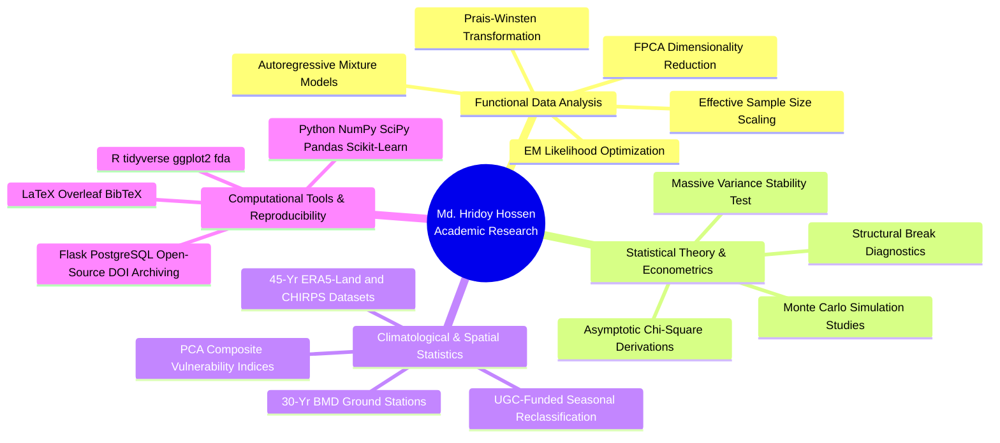

<div align="center">

# MD. HRIDOY HOSSEN
### **Statistician & Academic Researcher**
**Department of Statistics & Data Science | Islamic University, Kushtia, Bangladesh**

[-1E3A8A?style=flat-square&logo=academia&logoColor=white)](#-academic-background--education)
[](#-academic-background--education)
[-059669?style=flat-square)](#-academic-background--education)
[](#1-a-cluster-analysis-of-bangladeshs-monthly-climate-and-its-comparison-with-the-traditional-six-season-calendar)

<br/>

[](https://doi.org/10.5281/zenodo.23324622)
[](https://doi.org/10.5281/zenodo.22861296)
[](mailto:hridoy1922025.stat@std.iu.ac.bd)
[](mailto:hossenhridoy56@gmail.com)

</div>

---

## 🔬 Research Overview & Agenda
I am an academic researcher and statistics graduate specializing in **Functional Data Analysis (FDA)**, **Time Series Econometrics**, and **Applied Hydro-Climatological Modeling**. 

Currently, I serve as a **Research Assistant** on a UGC-funded climate research grant and am completing thesis research for the degree of **M.Sc. in Statistics** at Islamic University, Kushtia. My scholarly work focuses on:
- Formulating likelihood-based finite mixture models for second-generation functional data with temporal dependencies.
- Developing asymptotic distributional theory and noncentral representations for variance stability tests under structural breaks.
- Unsupervised pattern discovery and climatological reclassification using long-term surface observations and satellite reanalysis.
- High-performance, reproducible Monte Carlo simulation frameworks and academic computational platforms.

---

## 🌟 Flagship Research: Functional Data Analysis (FDA)

### **Model-Based Clustering of Climatological Functional Data with Temporal Dependence: An Autoregressive Mixture Model for Bangladesh Monsoon Rainfall**
*Thesis Research for M.Sc. in Statistics | Supervisor: Md. Matiur Rahman Molla, Associate Professor*

* **Scientific Problem:** Conventional functional clustering methods assume that annual curves at a given spatial location are conditionally independent given cluster membership. In multi-decadal climatology, inter-annual atmospheric persistence violates this assumption, causing standard model selection criteria (such as BIC) to over-estimate the number of true clusters.
* **Methodological Formulation:**
  - **Score Extraction:** Daily rainfall trajectories $Y_{i,t}(s)$ are mapped to $d$-dimensional principal score vectors $\boldsymbol{\xi}_{i,t} \in \mathbb{R}^d$ through pooled Functional Principal Component Analysis (FPCA).
  - **Dynamic Score Modeling:** Scores follow a stationary Gaussian vector AR(1) process around cluster-specific mean vectors:
    $$\boldsymbol{\xi}_{i,t} = \boldsymbol{\mu}_g + \boldsymbol{u}_{i,t}, \quad \boldsymbol{u}_{i,t} = \phi \boldsymbol{u}_{i,t-1} + \boldsymbol{\epsilon}_{i,t}, \quad |\phi| < 1, \quad \boldsymbol{\epsilon}_{i,t} \sim \mathcal{N}_d(\mathbf{0}, \boldsymbol{\Sigma}_g)$$
  - **Exact Likelihood Derivation:** Implementing a **Prais–Winsten transformation** whose Jacobian $(1-\phi^2)^{d/2}$ is preserved directly within the observed-data likelihood:
    $$\mathcal{L}(\boldsymbol{\Theta}) = \prod_{i=1}^N \left[ (1 - \phi^2)^{d/2} \sum_{g=1}^G \pi_g \prod_{t=1}^T f_d\left(\tilde{\boldsymbol{\xi}}_{i,t};\, a_t(\phi)\boldsymbol{\mu}_g,\, \boldsymbol{\Sigma}_g\right) \right]$$
* **Computational Estimation:** Generalized Expectation-Maximization (EM) algorithm with bounded optimization for $\phi$, likelihood decrease safeguards, and effective sample size adjustments $T_{\text{eff}} \approx T\frac{1-\phi}{1+\phi}$.
* **Empirical Application:** 76-year continuous daily precipitation reanalysis (1950–2025) from ECMWF ERA5-Land over Bangladesh.

---

## 📑 Research Projects & Scholarly Contributions

### 1. [A Cluster Analysis of Bangladesh's Monthly Climate and Its Comparison with the Traditional Six-Season Calendar](https://github.com/hossenhridoy56/Bangladesh-Seasonal-Reclassification)
* **Grant & Sponsorship:** University Grants Commission of Bangladesh (UGC) Funded Research Project (FY 2025–2026)
* **Authors:** Md. Matiur Rahman Molla, **Md. Hridoy Hossen**, Ayesha Siddika
* **Status:** Manuscript submitted to *Theoretical and Applied Climatology* (Currently under peer review, 2026)
* **Archived Dataset & Scripts:** [](https://doi.org/10.5281/zenodo.23324622)
* **Abstract & Key Contributions:**
  - Evaluated 30 years (1985–2014) of monthly ground observations comprising **10,865 station-months** across 33 BMD stations in a 6-variable climate space ($T_{\max}, T_{\min}$, rainfall, humidity, wind speed, cloud cover).
  - Applied K-Means, DBSCAN, and Hierarchical Agglomerative Clustering along with PCA dimensionality reduction and Dynamic Time Warping (DTW) to discover seasonal transition points.
  - Provided definitive empirical evidence identifying a four-season climatological structure (Winter, Pre-Monsoon, Monsoon, Post-Monsoon) with October serving as an independent transition month, critically challenging the traditional six-season paradigm.
* **Codebase & Supplementary Materials:** [GitHub Repository](https://github.com/hossenhridoy56/Bangladesh-Seasonal-Reclassification)

---

### 2. [A Novel Massive Variance Stability Test: Theory, Distributional Derivations, and Superior Performance Under Structural Breaks](https://github.com/hossenhridoy56/massive-variance-stability-test)
* **Focus Area:** Time Series Econometrics & Asymptotic Distribution Theory
* **Status:** Research Manuscript Prepared for Journal Submission & Open-Source Package
* **Permanent Archive:** [](https://doi.org/10.5281/zenodo.22861296) [](https://github.com/hossenhridoy56/massive-variance-stability-test/blob/main/LICENSE) [](https://archive.softwareheritage.org/swh:1:dir:fb0bcdf3cc816ccb214bf4da7c67ec3bba458077)
* **Theoretical Formulations & Derivations:**
  - Formulated the global Massive Variance Stability Test (MVT) statistic by partitioning a time series of length $n$ into $k$ equal-sized segments ($m = n/k$):
    $$Q_{\mathrm{MVT}} = \frac{m-1}{2\bar{v}^2} \sum_{j=1}^k (v_j - \bar{v})^2 \overset{d}{\longrightarrow} \chi^2_{k-1}$$
  - Derived exact finite-sample distributional representations and noncentral chi-square formulations under sudden parameter shifts.
  - Conducted extensive Monte Carlo simulations ($N = 10,000$ replications) assessing empirical size distortion, non-Gaussian innovations, and power comparisons against Bartlett, Levene, Goldfeld–Quandt, Breusch–Pagan, White, and ICSS procedures.
  - Validated empirically on 4,997 daily Gold Futures price observations (2005–2026), detecting structural volatility shifts ($p \approx 7.67 \times 10^{-258}$).
* **Codebase & Supplementary Materials:** [GitHub Repository](https://github.com/hossenhridoy56/massive-variance-stability-test)

---

### 3. Resolving Monsoon Timing Shifts in Bangladesh (1981–2025)
* **Focus Area:** Hydro-Climatic Dynamics, Bayesian Inference & Teleconnections
* **Overview:** Ingested 45 years of daily precipitation from ERA5-Land and CHIRPS datasets across Bangladesh. Formulated rainfall-based indices to resolve monsoon onset, peak, and withdrawal shifts. Implemented Bayesian autoregressive models incorporating El Niño–Southern Oscillation (ENSO) indices alongside Mann-Kendall trend detection with False Discovery Rate (FDR) control.

---

### 4. Climate-Health Vulnerability Assessment in Bangladesh
* **Focus Area:** Spatial Statistics, Principal Component Analysis & Environmental Epidemiology
* **Overview:** Developed an empirical district-level vulnerability framework merging 30 years (1995–2024) of ERA5-Land climate indicators with nationwide MICS 2025 public health and socio-demographic indicators. Extracted three principal components explaining **89.73% of total variance** to construct composite indices for Climate Exposure, Health Sensitivity, and Disaster Exposure across all 64 districts.

---

### 5. [Stratosphere Gateway: Departmental Computational Platform with Generative AI](https://github.com/hossenhridoy56/stratosphere-gateway)
* **Focus Area:** Scientific Web Infrastructure & Academic Workflow Automation
* **Live Deployment:** [stratosphere-gateway.onrender.com](https://stratosphere-gateway.onrender.com/)
* **Overview:** Designed a web-based departmental infrastructure utilizing Python (Flask), SQLAlchemy, PostgreSQL, and Bootstrap. Integrated Generative AI pipelines for verified academic document synthesis (transcripts, certificates, attendance analytics) and benchmarked concurrency resilience via Locust (24.4 RPS, 0% failure rate).

---

## 🗺️ Methodological Architecture & Research Ecosystem



---

## 🛠️ Computational & Statistical Toolkit

| Category | Tools & Methodologies |
| :--- | :--- |
| **Statistical Computing** | `R`, `Python (NumPy, SciPy, Pandas, Statsmodels, Scikit-learn, Xarray)`, `SPSS`, `STATA`, `SAS` |
| **Mathematical & Statistical Theory** | Functional Data Analysis (FDA), Finite Mixture Models, Time Series Asymptotics, Bayesian Inference |
| **Machine Learning & Pattern Discovery** | Model-based Clustering, K-Means, DBSCAN, Gaussian Mixture Models, Agglomerative Clustering, PCA, DTW |
| **Typesetting & Academic Publishing** | `LaTeX`, `Overleaf`, `BibTeX`, `R Markdown`, `Git / GitHub` |
| **Systems & Scientific Computing** | `Python (Flask)`, `PostgreSQL`, `SQLAlchemy`, `RESTful APIs`, `Locust Benchmarking` |

---

## 🎓 Academic Background & Education

* **Master of Science (M.Sc.) in Statistics (In Progress)**  
  *Department of Statistics & Data Science, Islamic University, Kushtia, Bangladesh*  
  *Program:* Thesis-based | *Expected Completion:* March 2027  
  *Thesis Title:* *Model-Based Clustering of Climatological Functional Data with Temporal Dependence: An Autoregressive Mixture Model for Bangladesh Monsoon Rainfall*  
  *Supervisor:* Md. Matiur Rahman Molla, Associate Professor

* **Bachelor of Science (B.Sc.) in Statistics**  
  *Department of Statistics & Data Science, Islamic University, Kushtia, Bangladesh*  
  *Degree Duration:* Dec 2019 – Nov 2025 | **Final Grade: CGPA 3.46 / 4.00** (160 Credits)  
  *Core Subject Areas:* Statistical Inference, Regression Analysis, Time Series Analysis, Probability and Measure, Bayesian and Classical Inference, Matrix Algebra, Sampling Techniques, Multivariate Analysis, Stochastic Processes.

* **Language Qualifications:**  
  *IELTS Academic:* **Overall Band Score 7.0 (CEFR C1)**  
  *(Listening: C1, Reading: C1, Speaking: B2, Writing: B2)*

---

## 📚 Selected Citations & Reference Records

```bibtex
@article{molla2026cluster,
  title={A Cluster Analysis of Bangladesh's Monthly Climate and Its Comparison with the Traditional Six-Season Calendar},
  author={Molla, Md. Matiur Rahman and Hossen, Md. Hridoy and Siddika, Ayesha},
  journal={Theoretical and Applied Climatology (Under Peer Review)},
  year={2026},
  doi={10.5281/zenodo.23324622}
}

@software{hossen2026mvt,
  author={Hossen, Md. Hridoy},
  title={{Massive Variance Stability Test (MVT): Research Code and Supplementary Materials}},
  year={2026},
  version={v1.0.0},
  publisher={Zenodo},
  doi={10.5281/zenodo.22861296},
  url={https://doi.org/10.5281/zenodo.22861296}
}
```

---

## 📬 Academic Inquiries & Collaboration
I welcome scholarly dialogue, research inquiries, and potential doctoral / pre-doctoral research opportunities in Functional Data Analysis, Time Series Econometrics, and Applied Climatology.

- 🏢 **Office:** Department of Statistics & Data Science, Islamic University, Kushtia-7003, Bangladesh  
- ✉️ **Academic Email:** [hridoy1922025.stat@std.iu.ac.bd](mailto:hridoy1922025.stat@std.iu.ac.bd)  
- ✉️ **Personal Email:** [hossenhridoy56@gmail.com](mailto:hossenhridoy56@gmail.com)  
- 🌐 **GitHub Codebase:** [github.com/hossenhridoy56](https://github.com/hossenhridoy56)  
- 📦 **Zenodo Author Profile:** [Zenodo / hossenhridoy56](https://zenodo.org/search?q=metadata.creators.person_or_org.name:%22hossenhridoy56%22)
